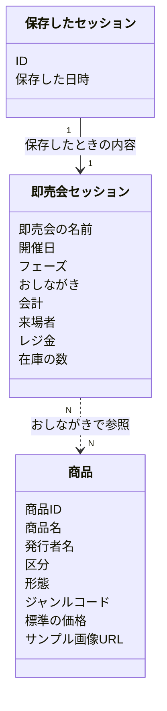

# Libre Shelf の仕様

Libre Shelf は、個人で同人誌を頒布するサークルが、同人誌即売会の会場で使うレジの Web アプリケーションである。前日の準備から、会場での販売、帰着後の振り返りまでを、1 台の端末で記録する。

画面の文言と文書でアプリの名前を書くときは、「Libre Shelf」と書く。書き出すファイルの名前と形式の識別子（`libre-shelf-backup` など）は、この表記に合わせない。ブラウザのタブに出るページのタイトル（`index.html` の `<title>`）も「Libre Shelf」にする。

データはすべて端末のブラウザ（localStorage）に置く。サーバ（Cloudflare Workers の Worker）は状態を持たず、DB も持たない。サーバの役割はアプリのファイルを配ることと、ISDN の情報の取得を中継すること（[商品マスタ.md](商品マスタ.md)）だけである。

## 機能

| 機能 | 仕様 |
|---|---|
| 商品マスタ | [商品マスタ.md](商品マスタ.md) |
| データの管理（まとめて書き出す、読み込む） | [データの管理.md](データの管理.md) |
| 即売会 | [即売会/index.md](即売会/index.md) |
| ナビゲーション | [ナビゲーション.md](ナビゲーション.md) |
| バーコードのカメラ読み取り | [バーコードのカメラ読み取り.md](バーコードのカメラ読み取り.md) |
| デザインのルール（色、タイポグラフィ、余白、文言と書式、ボタン、処理の失敗、成功、確認、フレーム） | [デザイン/index.md](デザイン/index.md) |

機能とは別に、アプリを紹介するランディングページを、アプリのパス `/` に置く（[ランディングページ.md](ランディングページ.md)）。

SNS やチャットに URL を貼ったときに出るタイトル、説明、画像は、[リンクを共有したときの表示.md](リンクを共有したときの表示.md) にある。

この仕様の中のパスは、`libre/` の中から書く（`src/...`、`shared/...`、`e2e/...`）。`ui/` で始めるパスは、`libre/` と並べて置くデザインシステムのパッケージ（部品、デザインシステム、画面の枠）を指す。

API の詳細（パス、パラメーター、型、ステータスコード、エラーの形）は、コードから生成する OpenAPI のドキュメントを正とする。開発サーバーでは `/api/v1/docs` で見られる。機能ごとの仕様には OpenAPI の定義からは読み取れない要件だけを書く。

## 前提

- 利用者は個人で頒布するサークル 1 つである。1 台の端末を 1 つのサークルで使う
- 免税事業者として扱い、消費税を計算しない。金額は税込で記録する
- 軽減税率の対象品（食品など）は扱わない
- 利用者は、公開されたサイトにアクセスして使う。アプリ自身は認証しない
- 端末のブラウザのデータを消すと、記録も消える。残したいデータは、アプリの画面から JSON ファイルに書き出し、利用者が保管する（[商品マスタ.md](商品マスタ.md)、[即売会/セッションの保存.md](即売会/セッションの保存.md)）

## 概念モデル

テーブルやカラムではなく、システムが扱う概念とその関係を示す。

- 商品: 頒布する同人誌やグッズ。13 桁のコードで識別する。先頭が 278 か 279 なら ISDN、271 ならインストアコード（ISDN を持たない商品）である。区分（オリジナルかパロディか）と形態（同人誌かグッズかなど）を持つ
- 即売会セッション: 即売会 1 日分の運営データ。おしながき（頒布する商品と価格）、会計、来場者、レジ金、在庫の数を持つ。フェーズは、前日準備から帰着後の作業までのどこにいるかを表す（[即売会/index.md](即売会/index.md) の「状態」）
- 保存したセッション: 帰着後の作業を終えたセッションを、端末に 1 件ずつ保存したもの。保存したセッションを集めたものをセッションの履歴と呼び、即売会の一覧と結果画面で見る

## まだ決まっていないこと

- なし
